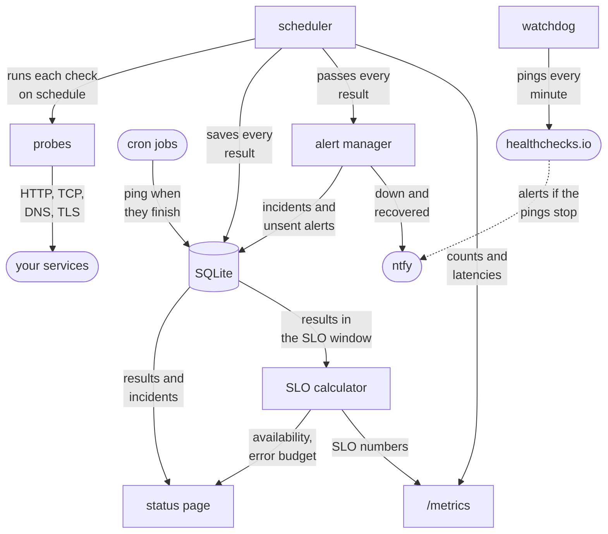
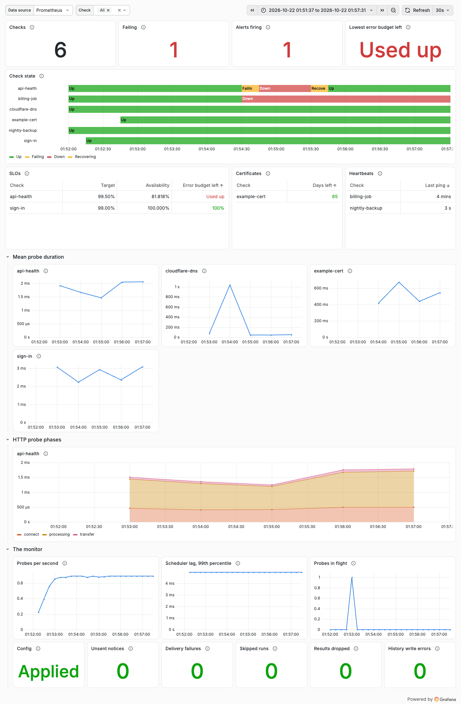

# synthetic-monitor

[](https://github.com/MSJawad/synthetic-monitor/actions/workflows/ci.yml)

A synthetic monitor I wrote in Go. It checks your services from the outside
on a schedule, the way a user would, and sends you an alert when something
breaks and another when it's back. It also tracks uptime against an SLO and
puts it all on a status page, with the last 90 days and every incident in
them.

It's running right now at https://status.92-5-186-10.sslip.io, keeping an
eye on my [apartment-finder](https://github.com/MSJawad/apartment-finder)
project.

## How it works



It's all one Go process. The scheduler runs every check on its own interval
and hands each result to three places: SQLite keeps the history, the alert
manager decides whether to alert, and `/metrics` exposes it to Prometheus.
The status page and the SLO numbers are worked out from the history.

Two things work the other way around. Cron jobs and workers the monitor
can't reach ping it when they finish, and their check fails if a ping
doesn't show up in time. And since a dead monitor can't tell you it's dead,
it pings healthchecks.io every minute, which alerts if the pings stop.

## What it checks

| Type | Passes when |
|---|---|
| `http` | a request gets the expected status, and optionally some text in the body, in time |
| `steps` | a few requests in a row all pass, like signing in and then loading a page as that user |
| `tcp` | a port accepts a connection |
| `dns` | a name resolves, optionally to the addresses you expect |
| `tls` | a certificate is valid and has enough days left |
| `heartbeat` | something pinged the monitor recently |

A check looks like this:

```yaml
checks:
  - name: api
    interval: 30s
    timeout: 5s
    slo: {target: 99.5}
    http:
      url: https://api.example.com/ready
```

Passwords and tokens go in environment variables (`${PASSWORD}`), never in
the file. [`examples/checks.yaml`](examples/checks.yaml) has the basic types,
and [`examples/app-checks.yaml`](examples/app-checks.yaml) has a sign-in
flow, a heartbeat and secrets.

## Running it

```sh
go run ./cmd/synthetic-monitor -config examples/checks.yaml
```

Then open http://localhost:8080. To get alerts, set `NTFY_URL` to an
[ntfy](https://ntfy.sh) topic. You can edit the checks file while it's
running and it picks up the changes, no restart needed. Every flag,
environment variable, endpoint and metric is in
[docs/reference.md](docs/reference.md).

## Deploying

There's a Helm chart. CI publishes it with an arm64 and amd64 image for
every commit on `main`:

```sh
kubectl create namespace synthmon
kubectl -n synthmon create secret generic synthetic-monitor --from-literal=NTFY_URL=https://ntfy.sh/<your-topic>
helm install synthetic-monitor oci://ghcr.io/msjawad/charts/synthetic-monitor -n synthmon \
  --version <chart version> --set existingSecret=synthetic-monitor -f examples/checks.yaml
```

[`values.yaml`](charts/synthetic-monitor/values.yaml) covers the rest, like a
public address for the status page, Prometheus scraping and the Grafana
dashboard.

## In production

It runs on a k3s cluster on one free Oracle Cloud Arm VM (2 cores, 12 GB),
next to apartment-finder. Flux deploys it: a push to `main` is live in about
4 minutes, and CI only goes green once the status page reports the new
commit. Prometheus and Grafana for the whole cluster come from this repo too,
in [`deploy/flux`](deploy/flux).

To make sure it actually works, I broke things on purpose:

- I scaled apartment-finder's API down to zero for 3 minutes. The monitor
  sent one alert 90 seconds in, and one recovery notice 56 seconds after the
  API came back. Nothing else.
- I scaled the monitor itself down to zero. healthchecks.io alerted about 5
  minutes later and cleared as soon as it came back.

More on the setup, and the two things that broke on the first deploy, in
[docs/production.md](docs/production.md).

<picture>
  <source media="(prefers-color-scheme: dark)" srcset="docs/images/grafana-dashboard-dark.png">
  
</picture>

## Performance

On the production VM, next to the apps it watches, one instance keeps up
with 2,000 HTTP checks a second, or 500 HTTPS ones (the TLS handshake is
the expensive part). At a normal 30 second interval that's 60,000 HTTP
checks. On an 8-core M1 running Linux it did 24,000 a second. The numbers,
how I measured them and where the CPU goes are in
[docs/performance.md](docs/performance.md).

## How it behaves

- It alerts after 3 failures in a row and sends a recovery after 2 passes in
  a row, so one blip doesn't page anyone. Both numbers can be changed per
  check.
- Checks with an SLO also alert when failures keep coming often enough to
  burn through the error budget too fast, like half the probes failing on
  and off. That's still one alert, and the recovery waits until the budget
  has stopped burning.
- Alerts are saved before they're sent, and it keeps retrying until ntfy
  takes them, so a restart in the middle of an incident won't lose one.
- Every probe opens a fresh connection, with its own DNS lookup and TLS
  handshake, the same as a new visitor.
- SLOs are worked out from its own history, over the last 30 days by
  default.
- The status page has a bar for each of the last 90 days: red if the check
  was down that day, amber if it was failing on and off. Below that is a
  list of the incidents. Probe results are only kept for 35 days, so it
  keeps a count of each day's probes for the bars.
- History lives in SQLite. At this scale it's plenty, and there's no
  database to run. Why not Postgres or a time-series database is in
  [docs/decisions.md](docs/decisions.md#history-in-sqlite-not-postgres-or-a-time-series-database),
  along with the reasoning behind everything else here.
- It runs as one pod. A deploy replaces it, so there are a few seconds
  without probes.
- The status page has no JavaScript and only shows check names, never
  hostnames.

## Development

Needs Go 1.27.3 or later.

```sh
go test -race ./...
golangci-lint run
```
