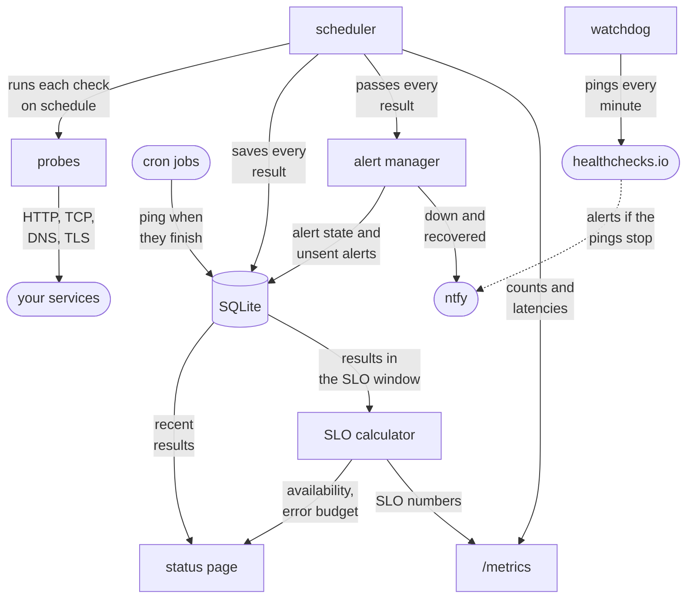

# synthetic-monitor

A synthetic monitor I wrote in Go. It checks your services from the outside
on a schedule, the way a user would, and sends you an alert when something
breaks and another when it's back. It also tracks uptime against an SLO and
puts it all on a status page.

It's running right now at https://status.92-5-186-10.sslip.io, keeping an
eye on my [apartment-finder](https://github.com/MSJawad/apartment-finder)
project.

## How it works



It's all one Go process. The scheduler runs every check on its own interval
and hands each result to three places: SQLite keeps the history, the alert
manager decides whether to alert, and `/metrics` exposes it to Prometheus.
The status page and the SLO numbers are worked out from the history.

Two things work the other way around. Cron jobs and workers the monitor
can't reach ping it when they finish, and their check fails if a ping
doesn't show up in time. And since a dead monitor can't tell you it's dead,
it pings healthchecks.io every minute, which alerts if the pings stop.

## What it checks

| Type | Passes when |
|---|---|
| `http` | a request gets the expected status, and optionally some text in the body, in time |
| `steps` | a few requests in a row all pass, like signing in and then loading a page as that user |
| `tcp` | a port accepts a connection |
| `dns` | a name resolves, optionally to the addresses you expect |
| `tls` | a certificate is valid and has enough days left |
| `heartbeat` | something pinged the monitor recently |

A check looks like this:

```yaml
checks:
  - name: api
    interval: 30s
    timeout: 5s
    slo: {target: 99.5}
    http:
      url: https://api.example.com/ready
```

Passwords and tokens go in environment variables (`${PASSWORD}`), never in
the file. [`examples/checks.yaml`](examples/checks.yaml) has the basic types,
and [`examples/app-checks.yaml`](examples/app-checks.yaml) has a sign-in
flow, a heartbeat and secrets.

## Running it

```sh
go run ./cmd/synthetic-monitor -config examples/checks.yaml
```

Then open http://localhost:8080. To get alerts, set `NTFY_URL` to an
[ntfy](https://ntfy.sh) topic. You can edit the checks file while it's
running and it picks up the changes, no restart needed. Every flag,
environment variable, endpoint and metric is in
[docs/reference.md](docs/reference.md).

## Deploying

There's a Helm chart. CI publishes it with an arm64 and amd64 image for
every commit on `main`:

```sh
kubectl create namespace synthmon
kubectl -n synthmon create secret generic synthetic-monitor --from-literal=NTFY_URL=https://ntfy.sh/<your-topic>
helm install synthetic-monitor oci://ghcr.io/msjawad/charts/synthetic-monitor -n synthmon \
  --version <chart version> --set existingSecret=synthetic-monitor -f examples/checks.yaml
```

[`values.yaml`](charts/synthetic-monitor/values.yaml) covers the rest, like a
public address for the status page, Prometheus scraping and the Grafana
dashboard.

## In production

It runs on a k3s cluster on one free Oracle Cloud Arm VM (2 cores, 12 GB),
next to apartment-finder. Flux deploys it: a push to `main` is live in about
4 minutes, and CI only goes green once the status page reports the new
commit. Prometheus and Grafana for the whole cluster come from this repo too,
in [`deploy/flux`](deploy/flux).

To make sure it actually works, I broke things on purpose:

- I scaled apartment-finder's API down to zero for 3 minutes. The monitor
  sent one alert 90 seconds in, and one recovery notice 56 seconds after the
  API came back. Nothing else.
- I scaled the monitor itself down to zero. healthchecks.io alerted about 5
  minutes later and cleared as soon as it came back.

More on the setup, and the two things that broke on the first deploy, in
[docs/production.md](docs/production.md).

<picture>
  <source media="(prefers-color-scheme: dark)" srcset="docs/images/grafana-dashboard-dark.png">
  
</picture>

## Performance

On the production VM, next to the apps it watches, one instance keeps up
with 2,000 HTTP checks a second, or 500 HTTPS ones (the TLS handshake is
the expensive part). At a normal 30 second interval that's 60,000 HTTP
checks. On an 8-core M1 running Linux it did 24,000 a second. The numbers,
how I measured them and where the CPU goes are in
[docs/performance.md](docs/performance.md).

## Design decisions

The main ones, short. The full list with all the reasoning is in
[docs/decisions.md](docs/decisions.md).

**SQLite, not Postgres or a time-series database.** Twenty checks every 30
seconds is less than one write a second, and the writer handles about
170,000. Postgres would be one more thing to run, secure and back up, for
data only this process touches. A time-series database like Prometheus is
made for numbers, not individual results with an error attached, and a
status page shouldn't go down because another system did. If several
monitors ever need to share one history, that's when Postgres makes sense.

**One alert per incident.** A check needs 3 failures in a row to alert and
2 passes in a row to recover. One blip doesn't wake anyone up, and something
flapping stays one alert instead of a stream of them.

**Alerts survive restarts.** When a check goes down, its new state and the
alert are saved together in SQLite, and a separate loop keeps sending saved
alerts to ntfy until ntfy takes them. A restart in the middle of an incident
doesn't lose the alert or the recovery. At worst an alert gets sent twice,
and for alerts that's the right way to fail.

**Every probe is a new visitor.** Probes never reuse connections, so each
one does DNS, connects and does a TLS handshake. With reuse, a broken DNS
record or an expired certificate could hide behind a connection that's still
open.

**SLOs come from the monitor's own history.** Availability is the share of
probes in the window that passed. Prometheus keeps 15 days by default, which
can't cover a 30-day SLO, so the monitor works it out from SQLite. Until it
has a full window of history, the status page says what period the number
covers.

**One pod.** History and alert state live in one SQLite file with one
writer, so it runs as a single pod that gets replaced, not rolled. Two
copies would both probe and both alert. The cost is a few seconds without
probes during a deploy.

**No JavaScript on the status page.** It's rendered on the server, charts
included, so the page can block scripts completely. It only shows check
names, never hostnames, since it's public.

## Limits

What v1 doesn't do, and what I'd add next:

- It watches from one place. In production it's on the same VM as the site,
  so it can't tell "down for everyone" from "down from here". A second
  instance somewhere else, alerting only when both agree, would fix that.
- Alerts need failures in a row. If one of two pods breaks, about half the
  probes fail at random, and it alerts and recovers over and over. Alerting
  on how fast the error budget is burning would handle that better.
- Alerts only go to ntfy, and there's no way to silence them for planned
  work.
- History lives on one disk. Streaming it to object storage with Litestream
  would protect it.
- It speaks HTTP, not JavaScript, so a page that loads but fails to render
  still passes.

## Development

Needs Go 1.27.3 or later.

```sh
go test -race ./...
golangci-lint run
```
