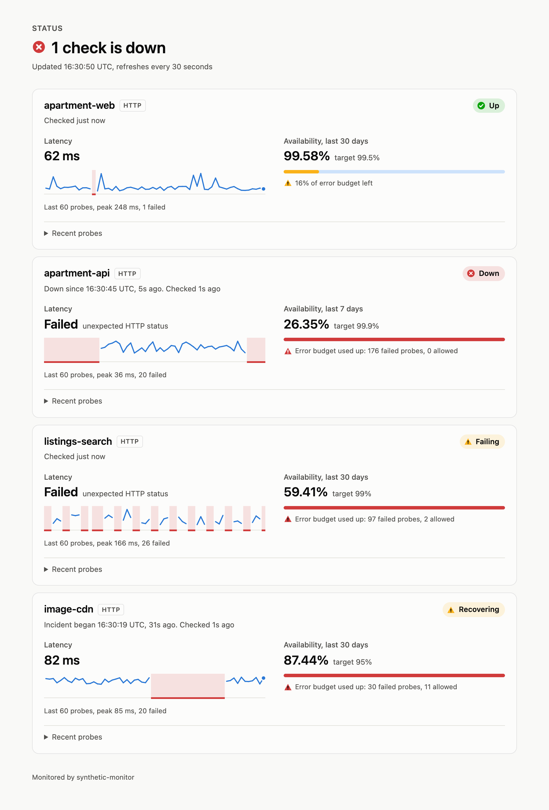
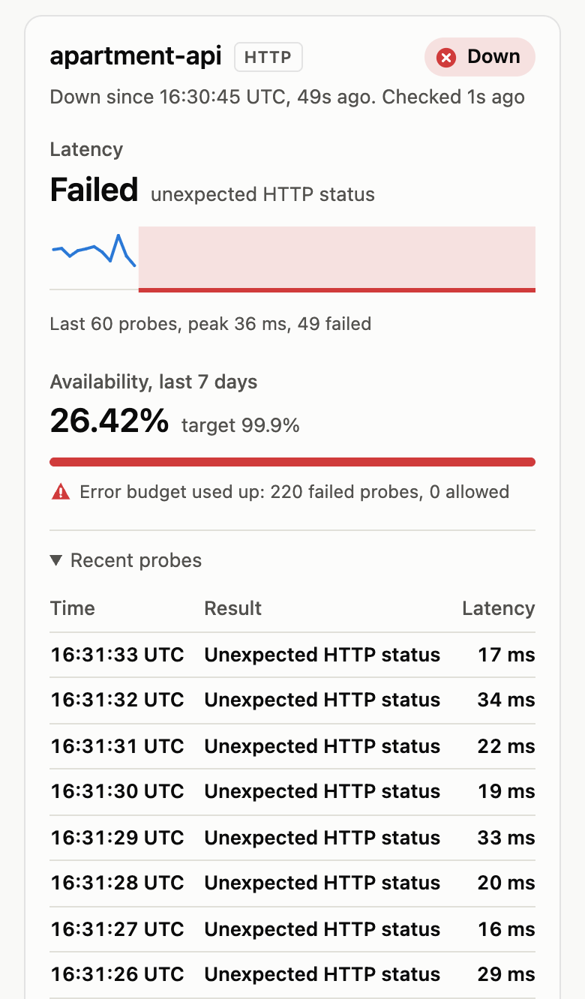

# synthetic-monitor

A synthetic monitoring service in Go. It probes HTTP(S), TCP, DNS and TLS
endpoints on a schedule, runs multi-step journeys such as signing in, and
listens for heartbeats from jobs it cannot reach. It records availability and
latency, tracks SLOs and error budgets, and sends a webhook alert when a check
breaks and a notice when it recovers.

Status: v1 in progress.

## Status page

<picture>
  <source media="(prefers-color-scheme: dark)" srcset="docs/images/status-page-dark.png">
  
</picture>

On a phone, with a check's recent probes expanded:

<picture>
  <source media="(prefers-color-scheme: dark)" srcset="docs/images/status-page-mobile-dark.png">
  
</picture>

The screenshots show demo checks against a local target made to fail on
purpose. The page follows the viewer's light or dark preference.

## Checks

Each check in the checks file has a name, an interval and one type:

| Type | Passes when | Example |
|---|---|---|
| `http` | a request gets an expected status, and optionally a body containing some text, within the timeout; it can send a method, headers and a body | a health endpoint |
| `steps` | a sequence of HTTP requests all pass, sharing cookies and values extracted from JSON responses | sign in, then fetch a page as that user |
| `tcp` | a TCP connection opens | a database port |
| `dns` | a name resolves, optionally to expected addresses | a domain at its DNS provider |
| `tls` | a certificate chain verifies and has at least `min_days_remaining` days left | the certificate in front of an API |
| `heartbeat` | something pinged `POST /heartbeat/{name}` within the last period plus grace | a cron job that should run every hour |

Any check can also fail for being slower than `max_latency`, and can have an
SLO. Header values and bodies can refer to environment variables as
`${NAME}`, which keeps secrets out of the file.
[`examples/checks.yaml`](examples/checks.yaml) runs against public endpoints;
[`examples/app-checks.yaml`](examples/app-checks.yaml) shows each type for a
typical web app.

## Running

```sh
go run ./cmd/synthetic-monitor -config examples/checks.yaml -log-level debug
```

| Flag | Default | Purpose |
|---|---|---|
| `-config` | (required) | checks file, see [`examples/checks.yaml`](examples/checks.yaml) |
| `-listen` | `:8080` | HTTP server address |
| `-history` | `history.db` | SQLite file of probe results |
| `-history-retention-days` | `35` | days of results kept; must cover every SLO window |
| `-max-concurrent-probes` | `64` | cap on probes in flight across all checks |
| `-config-poll-interval` | `5s` | how often the checks file is checked for changes |
| `-shutdown-timeout` | `30s` | how long probes in flight get to finish after SIGTERM |
| `-log-level` | `info` | `debug` also logs every successful probe |
| `-debug-listen` | (off) | address for `/debug/pprof/`, e.g. `127.0.0.1:6060`; never expose it publicly |
| `-watchdog-interval` | `1m` | how often to request `WATCHDOG_URL` |

Alerts go to [ntfy](https://ntfy.sh), configured through the environment so the
topic can live in a secret:

| Variable | Purpose |
|---|---|
| `NTFY_URL` | topic to publish to, e.g. `https://ntfy.sh/<long-random-topic>`; without it, notifications are only logged |
| `NTFY_TOKEN` | optional bearer token, for protected topics or self-hosted servers |
| `HEARTBEAT_TOKEN` | token jobs send to ping heartbeat checks; required if there are any |
| `WATCHDOG_URL` | URL at an outside service, such as a [healthchecks.io](https://healthchecks.io) ping URL, requested every minute while the monitor runs, so that service alerts when the monitor goes silent |

Edits to the checks file are applied within one poll interval, or at once on
`SIGHUP`. An invalid file is rejected and logged, and the previous checks keep
running. On `SIGTERM` or Ctrl-C, `/readyz` turns unready, no new probes start,
and probes in flight get `-shutdown-timeout` to finish. Their results and
notifications then get up to 5 more seconds to be written before the process
exits.

| Endpoint | Purpose |
|---|---|
| `GET /` | status page |
| `GET /api/status` | the status page's data as JSON |
| `GET /metrics` | Prometheus metrics |
| `GET /healthz` | liveness: the process is up |
| `GET /readyz` | readiness: `503` once shutdown has started |
| `POST /heartbeat/{check}` | ping a heartbeat check, with `Authorization: Bearer $HEARTBEAT_TOKEN`; `204` once saved |

### Metrics

Per-check series are labelled only with `check`; join on
`synthetic_check_info` for a check's `type`.

| Metric | Type | Meaning |
|---|---|---|
| `synthetic_probes_total{check,result}` | counter | probes completed; `result` is `success` or the failure reason |
| `synthetic_probe_success{check}` | gauge | 1 if the last probe succeeded |
| `synthetic_probe_duration_seconds{check}` | histogram | probe duration |
| `synthetic_probe_http_phase_duration_seconds{check,phase}` | histogram | HTTP time by phase: `dns`, `connect`, `tls`, `processing`, `transfer` |
| `synthetic_tls_cert_expiry_timestamp_seconds{check}` | gauge | when the certificate chain stops verifying |
| `synthetic_heartbeat_last_ping_timestamp_seconds{check}` | gauge | when a heartbeat check was last pinged |
| `synthetic_check_info{check,type}` | gauge | 1 per configured check |
| `synthetic_slo_target_ratio{check}` | gauge | SLO target, e.g. `0.995` |
| `synthetic_slo_availability_ratio{check}` | gauge | fraction of probes in the SLO window that succeeded |
| `synthetic_slo_error_budget_remaining_ratio{check}` | gauge | error budget left; negative once overspent |
| `synthetic_scheduler_lag_seconds` | histogram | how late probes started, mostly waiting for a free slot |
| `synthetic_scheduler_skipped_runs_total{check}` | counter | runs skipped because an earlier probe overran |
| `synthetic_probes_in_flight` | gauge | probes running now |
| `synthetic_config_reloads_total{result}` | counter | config loads by `success` or `failure` |
| `synthetic_config_last_reload_successful` | gauge | 0 while a rejected config is being ignored |
| `synthetic_history_dropped_results_total` | counter | results not stored because the write queue was full |
| `synthetic_history_write_errors_total` | counter | failed history writes |
| `synthetic_alert_firing{check}` | gauge | 1 from the alert until the recovery notice, otherwise 0 |
| `synthetic_notifications_delivered_total{kind}` | counter | notifications accepted by ntfy: `alert`, `recovery`, `removed` |
| `synthetic_notification_delivery_failures_total{kind,permanent}` | counter | failed deliveries; `permanent="true"` ones were given up on |
| `synthetic_notifications_pending` | gauge | notifications saved but not yet delivered |
| `synthetic_alert_dropped_results_total` | counter | results not evaluated for alerting because its queue was full |
| `synthetic_watchdog_pings_total{result}` | counter | requests to `WATCHDOG_URL`: `success` or `failure` |

Failure reasons: `timeout`, `dns`, `connect`, `tls`, `cert_expiry`,
`http_status`, `http_body`, `dns_answer`, `latency`, `heartbeat_missed`,
`other`.

## Deploying

CI builds an image for arm64 and amd64 from every commit on `main` and pushes
it to `ghcr.io/msjawad/synthetic-monitor`, tagged with the commit SHA. The
Helm chart in [`charts/synthetic-monitor`](charts/synthetic-monitor) runs it
as a single pod, with the history on a persistent volume.

```sh
kubectl create namespace synthmon
# Every key in this Secret becomes an environment variable of the monitor:
# the ntfy topic (anyone who knows it can read it), the heartbeat token, the
# watchdog URL, and any ${NAME} the checks use.
kubectl -n synthmon create secret generic synthetic-monitor \
  --from-literal=NTFY_URL=https://ntfy.sh/<long-random-topic> \
  --from-literal=HEARTBEAT_TOKEN="$(openssl rand -hex 32)" \
  --from-literal=WATCHDOG_URL=https://hc-ping.com/<uuid>
helm install synthetic-monitor charts/synthetic-monitor -n synthmon \
  --set image.tag=<commit SHA> --set existingSecret=synthetic-monitor -f examples/checks.yaml
```

A checks file is also a values file: both keep the checks under `checks:`.
To change the checks, run `helm upgrade` with the edited file; the pod
applies them within about a minute, without restarting. Every setting is
described in [`values.yaml`](charts/synthetic-monitor/values.yaml), and
misspelled ones are rejected.

- **Private image:** while the GHCR package is private, the cluster needs a
  pull secret: a `docker-registry` Secret holding a token that can read
  packages, passed as `--set imagePullSecrets[0].name=<secret>`.
- **Prometheus and Grafana:** with
  [kube-prometheus-stack](https://github.com/prometheus-community/helm-charts/tree/main/charts/kube-prometheus-stack),
  `--set serviceMonitor.enabled=true --set serviceMonitor.labels.release=<its release name>`
  has Prometheus scrape the monitor, and `--set grafanaDashboard.enabled=true`
  loads the dashboard into Grafana. Otherwise, import
  [`synthetic-monitor.json`](charts/synthetic-monitor/dashboards/synthetic-monitor.json)
  into Grafana by hand.

<picture>
  <source media="(prefers-color-scheme: dark)" srcset="docs/images/grafana-dashboard-dark.png">
  
</picture>

The dashboard during a staged test: the API's health check failed for a
minute, going from up to failing, down (alert sent), recovering and up again
(recovery sent), and a job behind a heartbeat check stopped pinging.

## Performance

Measured on an Apple M1 (8 cores), on macOS and on Linux arm64 (the
production platform) in a VM on the same machine. Every check probes every
second against one local server; "sustained" means at least 99% of probes ran
on time with no failures. Full tables, method and profiles:
[docs/performance.md](docs/performance.md).

| | Linux arm64 | macOS |
|---|---|---|
| HTTP checks per second, sustained | 24,000+ (highest tested; 5.1 cores) | 8,000 (then out of local ports) |
| HTTPS checks per second, sustained | 5,000 (then out of CPU) | 5,000 (then out of CPU) |
| CPU per probe, whole pipeline | ~210 µs HTTP, ~1.3 ms HTTPS | ~230 µs HTTP, ~1.2 ms HTTPS |
| Memory per check | ~18 KB | ~18 KB |

At a 30-second interval, 24,000 probes a second would be 720,000 checks.

- **The monitor's own pipeline is under a tenth of the CPU.** The scheduler,
  metrics, SQLite history and alerting together take under 10% at 24,000
  probes a second; the rest is probing: the kernel opening and closing a
  fresh TCP connection per probe, the HTTP client, and garbage collection.
  A goroutine and timer per check cost about 1%.
- **TLS dominates HTTPS.** A handshake makes a probe six to eight times more
  expensive than plain HTTP, mostly the key exchange: Go negotiates the
  post-quantum hybrid X25519MLKEM768 by default, and its ML-KEM half costs
  more than its X25519 half.
- **Local ports run out before CPU.** Whichever side closes a connection
  first holds its port in TIME_WAIT for 30 to 60 seconds. On macOS, whose
  16,384 ephemeral ports are shared by the whole machine, HTTP probes failed
  at 12,000 a second with three quarters of the CPU idle. Linux only needs a
  port to be unique per destination, so in production, probing many hosts at
  30-second intervals, the limit is far away. Probes still close
  gracefully rather than with a reset that would avoid TIME_WAIT: a monitor
  should not fill its targets' logs with connection resets.

Numbers from the Oracle Ampere A1 node will be added once the service is
deployed there.

## Development

Requires Go 1.27.3 or later.

```sh
go test -race ./...
golangci-lint run
```

To try the chart on a local [k3d](https://k3d.io) cluster, without a
registry:

```sh
k3d cluster create synthmon
docker build -t synthetic-monitor:dev .
k3d image import synthetic-monitor:dev -c synthmon
helm install synthetic-monitor charts/synthetic-monitor -n synthmon --create-namespace \
  --set image.repository=synthetic-monitor --set image.tag=dev --set image.pullPolicy=Never \
  -f examples/checks.yaml
```

## Decisions

Each entry records what was chosen, the alternatives, and why.

### Standard library first

The HTTP server uses `net/http` without a framework: since Go 1.22 `ServeMux`
routes on method and path wildcards, which covers everything this service
needs. Logging uses `log/slog`. A third-party module is added only when the
alternative is reimplementing a well-solved problem, and each one is listed
here with its reason.

### Goroutine leak checks in every test package

`go.uber.org/goleak` (test-only) runs after each package's tests and fails
them if any goroutine they started is still alive. Go 1.27's built-in
`goroutineleak` profile was the stdlib alternative, but it only reports
goroutines blocked forever on a channel or lock that nothing can reach. It
would miss a scheduler loop that keeps ticking after `Stop()`, which is the
leak this service is most likely to have.

### CI actions pinned to commit SHAs

A Git tag such as `v7` can be moved to point at different code, so a
compromised action repository can change what runs in CI without any change
to this repository. Pinning to a full commit SHA makes the workflow run exactly
the reviewed code. Each pin carries a comment with its version for readability.

### Config: strict YAML, one block per check type

The checks file is decoded with `go.yaml.in/yaml/v3`, the YAML organisation's
maintained continuation of `gopkg.in/yaml.v3` (whose author marked it
unmaintained in April 2025). `sigs.k8s.io/yaml` was the alternative: it
converts YAML to JSON and reuses `encoding/json`, but it is a wrapper over the
same parser and adds a conversion step.

Unknown fields are rejected. A typo such as `timout: 5s` would otherwise be
silently ignored and the check would run with the default timeout, which is
the kind of bug that only shows up during an incident. Durations must carry a
unit (`30s`, not `30`), and every validation problem is reported at once.

A check's type comes from which block it sets (`http:`, `tcp:`, `dns:` or
`tls:`) instead of a separate `type:` field, so a type and its settings can
never disagree. Shared settings use YAML anchors rather than a custom
`defaults:` section.

The check `name` is its identity: config reloads, metrics, history and alert
state are all keyed by it.

### HTTP probes open a fresh connection every time

Keep-alives are disabled, so every probe resolves DNS, connects and completes
a TLS handshake, as a new visitor would. With connection reuse, a broken DNS
record or an expired certificate could go unnoticed for as long as an old
connection stayed open, and latency would look better than real users see it.
The cost is a little more work per probe, which is negligible at monitoring
rates. `httptrace` splits each probe's time into DNS, connect, TLS, server
processing and transfer, so a slow probe shows where the time went.

### One wrapper owns timeouts

Each probe type only knows how to do its own work and classify its own
errors. A shared wrapper applies the check's timeout through the context,
measures duration and enforces `max_latency`. When the deadline expires, a
probe can fail with many different errors (an i/o timeout, a cancelled read,
a DNS timeout); the wrapper reports all of them as `timeout`, so the failure
reason does not depend on which step was running at the time. A probe
cancelled by its caller, for example at shutdown, is reported as `canceled`
and is not the target's fault.

### One resolver for every probe, released as soon as a probe gives up

All probes resolve names with Go's own DNS client rather than the platform's
(`PreferGo`). It behaves the same on macOS and in the Linux container, has no
cache, so every probe sends real queries, and honours the probe's context.

The goroutine leak tests found one gap: when a probe times out, Go's resolver
cancels the lookup, but the UDP read in flight is bounded only by its
per-attempt deadline from `resolv.conf` (5 seconds by default). Each timed-out
DNS probe left a goroutine and a socket behind for up to 5 seconds, which
piles up against a dead nameserver. The resolver's dial function now closes
the connection as soon as the lookup's context ends.

### TLS checks fail before a certificate expires, not after

A TLS check performs a full verified handshake, so an expired, untrusted or
wrong-host certificate fails it as `tls`. A valid chain that expires within
`min_days_remaining` (default 14) fails it as `cert_expiry`. That gives an
alert while there is still time to act: automated renewal normally happens
around 30 days before expiry, so a certificate with under 14 days left means
renewal is broken.

The expiry date is the earliest `NotAfter` of any certificate in the chain,
not just the leaf, because an expired intermediate breaks verification just
as an expired leaf does. If the server's certificate verifies through several
chains (for example via a cross-signed intermediate), the connection keeps
working while any of them is valid, so the check uses the chain that lasts
longest.

### Scheduler: one goroutine per check, a shared limit on probes in flight

Each check has its own goroutine with its own timer, and a semaphore caps the
probes running at once across all checks. The alternative was a single timer
heap feeding a fixed pool of workers, which scales to hundreds of thousands
of checks with a constant number of goroutines. But it puts every check's
schedule in one shared structure that reloads must edit under a lock. With
one goroutine per check, stopping a check is cancelling its context, and a
goroutine costs a few kilobytes, so even ten thousand checks are cheap. The
benchmarks measure where this design stops being enough.

Each check's first probe comes at a random point within its interval, so
checks that share an interval do not all fire together after a start or
reload. The spread is capped at one minute: spreading an hourly check's
first probe over a whole hour would leave it without data for up to an hour
after every deploy. After that it keeps a fixed cadence: the next run is one interval after the
previous run was *scheduled*, not after it finished, so probe duration does
not make checks drift into alignment. A run that overruns its next slot (by
waiting for a free slot under the concurrency limit) skips the missed slots
instead of firing back to back, and a check never has two probes in flight.

### Two kinds of stop: stop scheduling, and abort

Stopping a check's schedule and cancelling its probe in flight are separate.
When a check is removed or changed by a reload, or the service shuts down,
its schedule stops but a probe already running finishes and its result is
recorded; a changed check's replacement waits for that probe before its own
first run. Probes are only aborted if shutdown's grace period runs out, and
an aborted probe's result is discarded because it says nothing about the
target. Writing results and notifications afterwards has a deadline of its
own, so a probe that hangs until the grace period ends cannot leave the
others' results unwritten.

### Reloads change only what changed

A new config is matched to the running one by check name. Unchanged checks
keep running on their existing schedule, untouched. Changed checks are
replaced, removed ones stop, and new ones start. An invalid config is
rejected as a whole and the previous one stays in effect.

### Deterministic time in tests

Scheduler and config-watcher tests run inside `testing/synctest` bubbles,
where time is simulated: a test covering five minutes of schedule finishes
in milliseconds, assertions can demand exact intervals, and there are no
sleeps to tune. The bubble also fails a test whose goroutines are still
blocked when it ends, which complements goleak.

### History in SQLite, not Postgres or a time-series database

Every probe result is kept for the retention period (35 days by default) in
an embedded SQLite database: it is what the status page shows and what SLOs
are computed from.

The scale decides it. Twenty checks every 30 seconds is under one write a
second and about 1.7 million rows a month, a few hundred megabytes. The
writer benchmarks at around 170,000 results a second, so SQLite has five
orders of magnitude of headroom here.

- **Postgres** would be another service to deploy, upgrade, back up and keep
  healthy, plus a network hop and credentials, for data that only this one
  process reads and writes. Its strengths (concurrent writers, a query
  planner for many users, replication) solve problems this service does
  not have. It becomes the right choice if several monitor instances must
  share one history.
- **A time-series database**, Prometheus included, is built for numeric
  samples at regular intervals, not for individual events carrying a failure
  reason and error text. Computing SLOs from Prometheus would also make the
  status page depend on another system being up (a monitor's status page
  should not), and Prometheus' default 15-day retention is shorter than a
  30-day SLO window. Prometheus still gets every metric for dashboards; it
  just is not the system of record.

The driver is `modernc.org/sqlite`, SQLite translated to pure Go. It is
slower than the cgo-based `mattn/go-sqlite3`, which does not matter at under
one write a second, and in exchange the binary builds with `CGO_ENABLED=0`:
it cross-compiles to arm64 without a C toolchain and runs on a distroless
image with no libc.

### Probes never wait for the disk

A single goroutine owns all writes and batches them into transactions.
Recording a result only puts it on a bounded queue; if the queue is ever
full (the disk has stalled), the result is dropped and counted in
`synthetic_history_dropped_results_total` rather than blocking. Blocking
would stall probes, distort their timings and turn a disk problem into
false alerts about the targets. WAL mode lets the status page read while
the writer writes, and old results are deleted in small chunks so pruning
never holds the write lock for long.

### SLOs are counted in probes and computed from history

A check's availability is the fraction of its probes in the SLO window that
succeeded, and its error budget is the number of failures the target allows
over that window: a 99.5% target over 86,400 probes allows 432 failures. The
budget's remaining fraction goes negative once it is overspent, so a dashboard
shows by how much rather than stopping at zero.

Counting probes rather than time keeps the maths exact and simple: every probe
is one equal sample. Time when the monitor itself was down produces no probes,
so it counts neither for nor against a check; the monitor cannot know what
happened while it was not looking.

The service computes SLOs from its own history every 30 seconds and exports
the results as gauges, rather than leaving Grafana to compute them from
counters with PromQL. A 30-day `increase()` needs Prometheus to retain 30 days
of data (its default is 15) and makes the numbers depend on Prometheus having
scraped without gaps. Computed from history, they survive restarts of either
service, and the status page and the dashboard always agree.

A config is rejected if a check's SLO window is longer than the history kept,
since its SLO would silently be computed over less data than it claims.

### Metrics carry only a check label

Every per-check series is labelled with `check` and nothing else that can
change; a check's type lives on `synthetic_check_info`. If `type` were a label
on every series, a reload changing a check from TCP to HTTP would leave the
TCP series behind, frozen at their last value. When a check is removed, its
series are deleted once its last probe has finished; deleting them at the
moment of the reload would let that probe recreate them, stale for good.
Failure reasons are a fixed set of ten, so label cardinality stays bounded.

### One alert per incident: thresholds and a state machine

Each check has a small state machine. `failure_threshold` failed probes in a
row (default 3) raise one alert; failures after that add nothing.
`success_threshold` successful probes in a row (default 2) then send one
recovery notice, and a failure before that starts the count again. So a
single blip pages nobody, and a target flapping between up and down stays in
one alert instead of producing a stream of alerts and recoveries. The names
match the Kubernetes probe fields with the same meaning. The transition
logic is a pure function, tested by replaying sequences such as
`FFFSFSFSFSS`.

The trade-off of counting consecutive probes is that a target failing two
probes in every three never alerts. That pattern shows up in the SLO and its
error budget instead.

### Notifications go through an outbox

Each state change and the notification it calls for are saved to SQLite in
one transaction. A separate goroutine delivers saved notifications oldest
first, retrying with backoff (1 second, doubling to 5 minutes) until ntfy
accepts each one, and deletes it only then. This is the transactional outbox
pattern, and it rules out the failure modes of the obvious designs:

- Saving the state, then sending: a crash in between records the alert as
  sent when it never was, and it is lost for good.
- Sending, then saving: a crash in between forgets the alert was sent, and
  the next run sends it again.
- Keeping state only in memory: every restart during an incident, such as a
  deploy, would alert again, and a recovery after the restart would never be
  announced.

With the outbox, a restart mid-incident neither re-alerts nor loses the
recovery, and notifications that could not be delivered (ntfy down, network
partition) survive restarts and go out in order once it is reachable. One
duplicate is still possible: if the process dies after ntfy accepts a
notification but before it is deleted, it is sent again on the next start.
Exactly-once delivery over a network is impossible without the receiver
deduplicating, and ntfy does not; at-least-once is the right side to err on
for alerts.

Rate limiting and server errors are retried. Other rejections, such as a
bad token, are permanent and dropped with an error log and metric, so one
undeliverable notification cannot block every later one.

### Removed checks resolve their alerts

A check removed from the config while its alert is firing would otherwise
never recover, leaving an incident open forever. Instead it gets a removal
notice once its last probe has finished, including checks removed while the
monitor was down, which are resolved at the next start.

### The status page is server-rendered and runs no JavaScript

The page is an `html/template` embedded in the binary. Charts are inline SVG
computed on the server, tooltips are SVG `<title>` elements, and the page
reloads itself every 30 seconds. Without scripts there is nothing to build or
bundle, it works with JavaScript disabled, and its Content-Security-Policy
can forbid scripts and inline styles outright, which removes cross-site
scripting as a class of bug. The cost is a full reload to refresh and plain
browser tooltips; every value is also in a "Recent probes" table, so nothing
is reachable only by hovering.

It shows check names, never their targets or raw error messages, because a
public status page should not reveal internal hostnames and addresses.
Failures are described by reason ("Connection failed", "Timed out").

A few details that are easy to get wrong:

- Availability is rounded *down*, so 99.996% shows as 99.995%, never as 100%.
- An exhausted error budget is described in probes ("12 failed probes, 1
  allowed"), because a percentage over a short window reads "overspent by
  35966%".
- The sparkline positions points by percentage of its width instead of
  scaling a `viewBox`, so its 2px line and round end dot stay undistorted at
  any width. Each of the last 60 probes has a fixed slot, so a new check fills
  in from the right rather than stretching three probes across the chart.
- Colours come from a palette validated for colour-vision deficiency in both
  light and dark mode, and status colours always come with an icon and a
  label, never colour alone.

### The image: a static binary on distroless

The Dockerfile compiles on the build machine's own architecture and
cross-compiles for the target (`GOARCH`), so the arm64 image builds on an
amd64 CI runner without emulating arm64 in QEMU, which would be several
times slower. That works because the binary has no C dependencies, thanks
to the pure-Go SQLite driver.

The runtime image is `distroless/static`: the binary, CA certificates (which
HTTPS and TLS probes need), timezone data and a non-root user, and no shell
or package manager. It is about 18 MB, 7 MB compressed, and there is little
in it for a vulnerability scanner to flag or an attacker to use. The user is set as a
number (`65532`), because Kubernetes can only enforce `runAsNonRoot` when it
can see the UID without reading the image's `/etc/passwd`. Base images are
pinned by digest, for the same reason actions are pinned to SHAs.

### One pod, replaced rather than rolled

The history and the alert state live in one SQLite file with one writer, so
the chart runs exactly one replica with the `Recreate` strategy: during an
upgrade the old pod stops before the new one starts. A rolling update would
briefly run two monitors, each probing and alerting on its own, and both
writing the same database. The cost is a gap of a few seconds without probes
during an upgrade. Running several replicas would need leader election, or
a shared database and a way to agree on who sends each alert, which is far
more machinery than a monitor of this size warrants.

The volume has `helm.sh/resource-policy: keep`, so uninstalling the chart
does not delete 30 days of history; installing the same release again picks
it up.

### Checks change without a restart

The checks are a ConfigMap mounted as a directory. The kubelet updates such
a mount in place when the ConfigMap changes (by swapping a symlink, usually
within a minute), and the monitor's poll picks the change up and applies only
what changed, so probes in flight finish and unchanged checks keep their
schedules. Two common patterns would defeat this: a `subPath` mount, which is
a copy made when the pod starts and never updated, and a `checksum/config`
annotation on the pod, which restarts the pod on every change. The chart uses
neither.

### Pod resources: a memory limit but no CPU limit

A CPU limit makes the kernel throttle the container once it uses its share
of a 100 ms period. A probe that is throttled mid-request takes longer, and
the monitor would report that delay as the target's latency. So the pod
requests a little CPU and has no limit. Memory has a limit, because memory
cannot be throttled, only exhausted: a leak should get this pod restarted,
not starve the rest of the node.

### Shutdown fits inside Kubernetes' grace period

When Kubernetes stops a pod it sends SIGTERM, waits
`terminationGracePeriodSeconds`, then kills it. The monitor gives probes in
flight `-shutdown-timeout` to finish and then up to 5 seconds to write their
results and notifications, so the chart sets the grace period 10 seconds
above the shutdown timeout, derived from the same value so the two cannot
drift apart.

### A pod that can do little besides probing

The container runs as a non-root user with a read-only root filesystem, no
Linux capabilities, no privilege escalation and the runtime's default
seccomp profile. It gets no Kubernetes API token, because it never calls the
API. The only writable places are the history volume and a small `/tmp` for
SQLite's temporary files.

### Secrets are referenced, never passed as values

The chart takes the name of an existing Secret rather than the secret values
themselves. Values files tend to end up in Git, and Helm stores every
release's values in the cluster, so an ntfy topic or a password passed as a
value would leak in both places.

Every key in that Secret becomes an environment variable (`envFrom`), rather
than the chart listing the keys it expects. Checks can refer to any variable
as `${NAME}`, so a fixed list would mean a chart change for every new check
that needs a password. The cost is that anything put in the Secret is
visible to the monitor, so it should be a Secret for the monitor alone.

### Chart values are validated

Helm ignores values it does not recognise, so a typo such as
`serviceMonitor.enable: true` would silently do nothing. The chart's
`values.schema.json` rejects unknown and mistyped values when installing,
in the same spirit as the strict checks file. The checks themselves are left
to the monitor to validate, so there is one set of rules, not two that could
disagree.

### Images built per commit, with plain docker commands

CI publishes an image for every commit on `main`, tagged with the commit SHA
and never `latest`: a tag that always means the same image makes a
deployment reproducible and a rollback a matter of naming the previous SHA.
The workflow calls `docker buildx` directly instead of using the
docker/*-action wrappers, which keeps third-party code away from the job
that holds a token able to push packages; its BuildKit image is pinned by
digest. After pushing, the job reads the image back from the registry and
checks that it holds both platforms.

### The dashboard: one chart per check, states as the status page names them

Latency gets a small chart per check rather than one chart with a line per
check. Checks differ by orders of magnitude (a 4 ms TCP connect beside an
8-second HTTP request), so a shared axis flattens all but one of them, and
more than a handful of lines would need more colours than can be told apart.
The charts show the mean, computed exactly from the histogram's sum and
count: with a few probes a minute per check, a percentile estimated from
histogram buckets would mostly report where the bucket boundaries are.
Heartbeat checks get no latency chart, since they are pinged rather than
timed; a table beside the SLOs shows how long ago each was last pinged.

The state timeline combines two metrics into the status page's four states:
`2 * alert_firing + 1 - probe_success` is 0 when up, 1 when failing below the
alert threshold, 3 when down and 2 when recovering. Failing and recovering
share a colour, as on the status page; they are told apart by their labels
and by always coming before and after "down". An overspent error budget
reads "Used up" rather than a percentage such as -981%, and every status
colour starts at an explicit value, so a panel with no data is never coloured
as if it were healthy or failing.

### Secrets in checks come from the environment, and never sit in URLs

A check can send headers and a body, and both are templates: `${NAME}` is
replaced by the environment variable `NAME` when the request is sent, so a
password or API key lives in a Kubernetes Secret rather than in the checks
file. The parsed config keeps the templates; only the prober expands them,
just before each request, so a secret never travels through the scheduler,
metrics or alerting, which log and display check configuration.

Variables are refused in URLs. Go's HTTP errors quote the URL
(`Get "https://..."`), and probe errors end up in logs and notifications, so
a key in a query string would leak on the first failure. A variable that is
unset or empty rejects the whole config: an empty secret is a deployment
mistake, and sending it would turn into a confusing stream of 401s instead
of one clear error at startup. Only `${NAME}` is special; a lone `$` is
literal, and `$$` writes one, so ordinary JSON bodies need no escaping.

### Multi-step checks start a new session every run

A `steps` check sends a sequence of requests, such as signing in and then
fetching a page that needs the session. Values pass between steps two ways:
cookies, kept in a cookie jar, and variables extracted from a JSON response
by a dotted path (`data.token`) and used in a later step's headers or body as
`${token}`. Each run gets a new, empty jar, for the same reason each probe
opens a new connection: the check should see what a new visitor sees. A jar
kept between runs would let a session from the last run hide a broken
sign-in. The check fails at the first failing step and names it in the
error. Extraction errors name the path that was missing, never the values
around it, because a response to a sign-in is full of secrets. A run shares
one timeout across all its steps, since the question is whether the journey
as a whole works in time.

### Heartbeat checks: the job reports in, and silence is the failure

Some things cannot be probed: a scheduled job on a private network has no
address to call, and the dangerous failure is not an error but the job
quietly not running. A heartbeat check inverts the probe: the job sends
`POST /heartbeat/{check}` when it finishes, and the check fails once the
last ping is older than its period plus a grace allowance. Missing data is
the alarm, which is exactly what log-based alarms treat as all clear.

The check is still run by the scheduler on its interval, so heartbeats reuse
everything else: thresholds, alerting, SLOs, history and the status page,
where they show when the last ping came instead of a latency. Until the
first ping, the clock starts when the check does, so a job that never pings
fails rather than staying grey forever.

- **The ping is saved before it is acknowledged.** A `204` means the ping is
  in SQLite and survives a restart; if it cannot be saved the job gets a
  `503` and can retry. Without that, a redeploy just after a daily job would
  forget its ping and raise a false alarm a day later.
- **Grace defaults to a tenth of the period, and at least a minute,** which
  absorbs jobs that start late or run long without tuning each check.
- **One bearer token for all pings, checked before the name,** so a caller
  without it cannot discover which checks exist. A token in the URL, the
  common alternative, would end up in access logs.

### A dead man's switch for the monitor itself

A monitor cannot report its own death: if its node, its cluster or its
network fails, every alert it would have sent fails with it. So the monitor
requests `WATCHDOG_URL` every minute, and an outside service such as
healthchecks.io alerts when those requests stop. It is the same idea as
heartbeat checks, pointed the other way.

The requests stop as soon as shutdown begins, so a deploy shows up as a
short gap; the outside service's grace period should cover one (a few
minutes). The URL usually identifies the account, so it is treated as a
secret: Go's HTTP errors quote the URL, and the watchdog logs only the
underlying cause.
